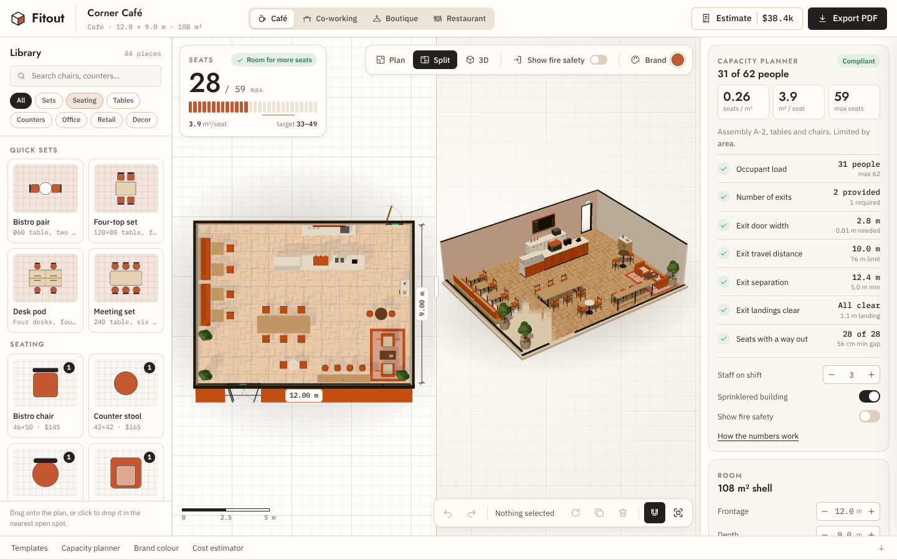

# Fitout: commercial space planner

Fitout is a browser-based 3D planner for cafés, small offices, boutiques and restaurants. You lay out the room, check seating capacity and fire egress, recolour everything in your brand, see a running furniture budget, and export an A3 layout sheet as a PDF.



## Run it

```bash
npm install
npm run dev       # http://localhost:5173
npm run build     # type-checks, then writes dist/ (static, relative paths)
npm run preview
```

The build output is static, so you can serve `dist/` from any host or subfolder.

## What's in it

**Workspace.** The top bar holds the project name, the template switcher, the live estimate and Export PDF. The furniture library sits on the left, the viewport in the middle, and the inspector on the right with selection, capacity and room settings.

**Plan and 3D.** The viewport shows the floor plan and 3D perspective side by side (Split), or one of them full width. Switching between Plan and 3D swings the camera: the frame dolly-zooms from a near-orthographic top-down view into a three-quarter perspective, and walls facing the camera drop to a curb so you can see in. In the plan you get a metre grid, dimension labels and a live scale bar.

**Editing.**
- Drag pieces in from the library, or click one to drop it in the nearest open spot.
- Drag placed items to move them (10 cm snap; hold Alt to place freely). Rotate with the handle or press `R`.
- Undo and redo cover every edit. Layouts save to `localStorage`.
- Sets (bistro pair, four-top, desk pod, meeting set) place a table with its chairs in one go.

**Templates.** Four starting layouts: café, co-working, boutique and restaurant. Each has its own room size, floor finish, exits, staff count and default brand colour. The templates section renders an eye-level "photograph" of each one with the engine.

**Capacity planner.** As you place chairs, the seat counter rolls up or down and the segmented meter fills against the code maximum, with the comfort band for that kind of room marked underneath. The inspector and the capacity section show the full calculation:

| Step | Rule used |
| --- | --- |
| Occupant load factor | IBC Table 1004.5: A-2 tables and chairs 1.4 m² net (80% of gross), B office 13.9 m² gross, M sales floor 5.6 m² gross |
| Exit count | 1 exit up to 49 occupants, 2 up to 500, 3 up to 1,000 |
| Door width | 5.1 mm per occupant, or 3.8 mm when sprinklered; 0.81 m minimum per door |
| Travel distance | Walking route from the most remote point to the nearest exit. 61 m unsprinklered; 76 m (A, M) or 91 m (B) sprinklered; 23 m or 30 m for a single exit |
| Exit separation | At least ½ of the room diagonal, or ⅓ when sprinklered |
| Exit landings | 1.1 m inside each door kept clear of solid furniture |

Posted capacity is the smallest of the area, exit and door-width limits. Sellable seats are that figure minus staff on shift. These numbers are planning estimates. Confirm them with your local building official.

**Fire safety overlay.** "Show fire safety" (or `F`) floods a walking grid from every exit. Solid furniture is inflated by half a body width, so routes only use gaps a person fits through. Escape routes then animate as flowing chevrons from well-spread seats to their nearest exit. The longest route is labelled with its distance, exit landings pulse green, and any blocked landing turns into red hatching.

**Brand colour.** Pick a preset, use the colour picker or type a hex value. Counter fronts, upholstery, the fascia sign, awnings, rugs, screens, the optional feature wall and the interface accents all ease to the new colour. The brand section shows a street-view render of the storefront in that colour.

**Cost estimator.** The Estimate button slides out a panel that prices every placed piece at Budget, Standard or Premium spec, adds 12% for delivery and install and 8% contingency, and shows the cost per seat and per m². A row flashes when its quantity changes. You can export the estimate as CSV.

**Export PDF.** The layout sheet assembles on screen first: the frame draws in, then the walls, then each piece of furniture pops into place, then the escape routes, the 3D render, the schedules and finally the issue stamp. Then it downloads as a vector A3 PDF (jsPDF). The sheet has the plan at a standard scale (1:50 to 1:200), a north arrow, a scale bar, the perspective render, capacity checks, the cost summary and a title block.

## Keyboard

| Key | Action |
| --- | --- |
| `1` `2` `3` | Plan, Split, 3D |
| `V` | Swing between plan and 3D |
| `F` | Show or hide fire safety |
| `R` / `Shift+R` | Rotate selection 45° (add `Alt` for 15°) |
| Arrows | Nudge 10 cm (`Shift` for 50 cm) |
| `Ctrl/Cmd+D` | Duplicate |
| `Delete` | Remove |
| `Ctrl/Cmd+Z`, `Ctrl/Cmd+Shift+Z` | Undo, redo |

## Code map

```
src/
  data/        catalog (44 pieces + sets), templates, brand presets, occupancy factors
  state/       zustand store with undo history and local persistence; toasts
  logic/       geometry, egress pathfinding, capacity checks, costing,
               plan symbols (shared by SVG and PDF), sheet layout, PDF writer
  engine/      Three.js planner: camera rig, room shell, procedural furniture,
               materials (shared, so brand recolours are a few uniform updates),
               egress ribbons, offscreen captures for photos and the sheet
  components/  top bar, library, viewport HUD and toolbars, inspector,
               cost drawer, export modal, page sections
```

All furniture is built from primitives and all textures are drawn procedurally, so the app loads no model or image files. The fonts are Jost for headings, IBM Plex Sans for body text and IBM Plex Mono for figures, all self-hosted through Fontsource.
